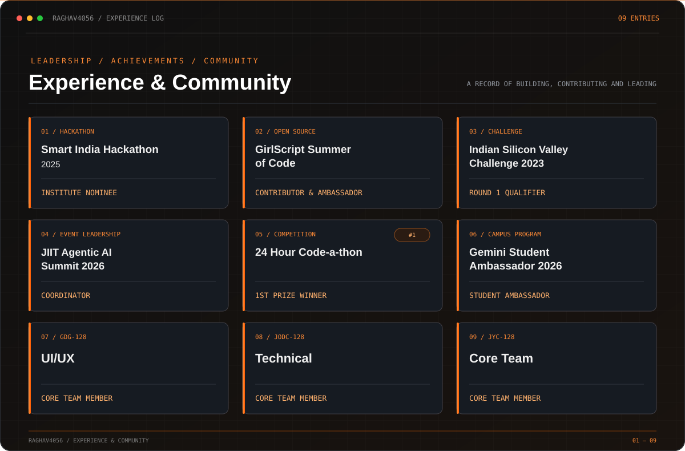
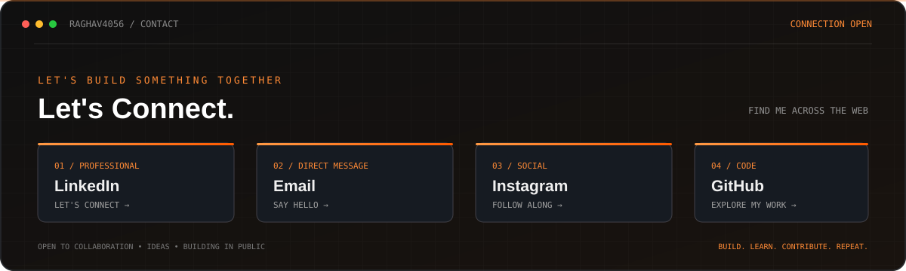

  

<!-- ABOUT ME SECTION -->

  

<!-- END ABOUT ME SECTION -->

<!-- PROFILE SNAPSHOT -->

  

<!-- END PROFILE SNAPSHOT -->

---

## 01 / ALL PROJECTS

  

The graphic is a visual index; use these direct links to open each project.

| Repository | Focus |
|---|---|
| [MiniLang-Interpreter](https://github.com/RAGHAV4056/MiniLang-Interpreter) | Command-based interpreter with C++ and Java versions |
| [ForgeLang-Interpreter](https://github.com/RAGHAV4056/ForgeLang-Interpreter) | C++ language tooling, tokenizer and parser |
| [LEETCODE-SOLUTIONS](https://github.com/RAGHAV4056/LEETCODE-SOLUTIONS) | C++17 solutions and DSA practice |
| [DEVELOPER-ARCHIVES](https://github.com/RAGHAV4056/DEVELOPER-ARCHIVES) | Technical notes and learning resources |
| [DIGITAL-PORTFOLIO](https://github.com/RAGHAV4056/DIGITAL-PORTFOLIO) | Responsive personal portfolio |
| [ClusterMind-GPU-Resource-Allocation-System](https://github.com/RAGHAV4056/ClusterMind-GPU-Resource-Allocation-System) | GPU scheduling, thermal monitoring and energy analysis |
| [CODENEXUS_LOCAL_VCS](https://github.com/RAGHAV4056/CODENEXUS_LOCAL_VCS) | Git-inspired C++ local version-control project — in progress |

---

## 02 / EXPERIENCE & COMMUNITY

  

---

## 03 / LET'S CONNECT

  

  <a href="https://www.linkedin.com/in/raghav-sharma-rs14102007">LinkedIn</a>
  &nbsp;•&nbsp;
  <a href="mailto:raghavsharma4056@gmail.com">Email</a>
  &nbsp;•&nbsp;
  <a href="https://www.instagram.com/raghavsharma732">Instagram</a>
  &nbsp;•&nbsp;
  <a href="https://github.com/RAGHAV4056">GitHub</a>

  Open to building, collaborating and learning together.
   
  **BUILD. LEARN. CONTRIBUTE. REPEAT.**

