<p align="center">
  
</p>
<!-- ABOUT ME SECTION -->
<p align="center">
  
</p>
<!-- END ABOUT ME SECTION -->
<!-- PROFILE SNAPSHOT -->
<p align="center">
  
</p>
<!-- END PROFILE SNAPSHOT -->
 
 
 
 
 <div align="center">

<table width="100%" bgcolor="#170B0A" border="1" bordercolor="#C64A12" cellpadding="18">
<tr>
<td bgcolor="#170B0A">

<table width="100%" bgcolor="#170B0A">
<tr>
<td width="20%" align="center" bgcolor="#170B0A">

</td>
<td bgcolor="#170B0A">
<p><b><font color="#FF6B00">@raghav4056</font></b></p>
<h1><font color="#FF6035">Raghav Sharma</font></h1>
<font color="#F5C2A5">B.Tech CSE @ JIIT'29</font>
<br/>
<font color="#D9B5A5">Building, experimenting and solving problems.</font>
</td>
<td align="center" bgcolor="#170B0A">
<h1><font color="#FF6035">5</font></h1>
<sub>TOTAL STARS</sub>
</td>
</tr>
</table>

<p align="center">
<code>C</code> <code>C++</code> <code>Java</code> <code>Python</code> <code>JavaScript</code> <code>TypeScript</code> <code>HTML</code> <code>CSS</code> <code>SQL</code> <code>MySQL</code>
</p>

</td>
</tr>
</table>

</div>

<br/>

<!-- ABOUT ME -->
<table width="100%" bgcolor="#170B0A" border="1" bordercolor="#C64A12" cellpadding="18">
<tr><td bgcolor="#170B0A">

<h2><font color="#FF6035">01 / ABOUT ME</font></h2>

```bash
$ whoami
Raghav Sharma
Computer Science Undergraduate @ JIIT
CGPA: 9.06 / 10
```

I'm a Computer Science undergraduate who enjoys building practical software, understanding how systems work, and solving problems through code.

- 🎓 B.Tech CSE — JIIT'29
- 📊 CGPA — 9.06/10
- 🧠 Data Structures & Algorithms
- ⚙️ Full-Stack Development
- 🖥️ Systems Programming
- 🤖 AI/ML Exploration
- 🌐 Open Source Development

> Understanding how things work, not just making them work.

</td></tr>
</table>

<br/>

<!-- LANGUAGES -->
<table width="100%" bgcolor="#170B0A" border="1" bordercolor="#C64A12" cellpadding="18">
<tr><td bgcolor="#170B0A">

<h2><font color="#FF6035">02 / LANGUAGES I KNOW & USE</font></h2>

<p align="center">

</p>

<p align="center">
<code>C</code> &nbsp; <code>C++</code> &nbsp; <code>Java</code> &nbsp; <code>Python</code> &nbsp; <code>JavaScript</code> &nbsp; <code>TypeScript</code> &nbsp; <code>HTML</code> &nbsp; <code>CSS</code>
</p>

<p align="center">
<b>Database Language & Technology</b>
</p>

<p align="center">

</p>

<p align="center">
<code>SQL</code> &nbsp; <code>MySQL</code>
</p>

</td></tr>
</table>

<br/>

<!-- TOOLS -->
<table width="100%" bgcolor="#170B0A" border="1" bordercolor="#C64A12" cellpadding="18">
<tr><td bgcolor="#170B0A">

<h2><font color="#FF6035">03 / TOOLS & ENVIRONMENTS</font></h2>

<p align="center">

</p>

</td></tr>
</table>

<br/>

<!-- FRAMEWORKS -->
<table width="100%" bgcolor="#170B0A" border="1" bordercolor="#C64A12" cellpadding="18">
<tr><td bgcolor="#170B0A">

<h2><font color="#FF6035">04 / FRAMEWORKS & DEVELOPMENT</font></h2>

<p align="center">

</p>

</td></tr>
</table>

<br/>

<!-- PROJECTS -->
<table width="100%" bgcolor="#170B0A" border="1" bordercolor="#C64A12" cellpadding="18">
<tr><td bgcolor="#170B0A">

<h2><font color="#FF6035">05 / ALL WORK REPOSITORIES</font></h2>

<sub>MY PROJECTS · DEVELOPMENT · LEARNING · EXPERIMENTS</sub>

<br/><br/>

### 01. MiniLang-Interpreter

**Mini-Lang Interpreter**

A lightweight custom language interpreter demonstrating lexical analysis, parsing and execution.

`C++` `Interpreter Design`

[VIEW REPOSITORY](https://github.com/RAGHAV4056/MiniLang-Interpreter)

---

### 02. ForgeLang-Interpreter

**Developer-First Programming Language**

A custom programming language focused on readability, simplicity, clean syntax and helpful diagnostics.

`C++` `Language Design`

[VIEW REPOSITORY](https://github.com/RAGHAV4056/ForgeLang-Interpreter)

---

### 03. LEETCODE-SOLUTIONS

**Data Structures & Algorithms**

A collection of LeetCode solutions organized by difficulty and topic, focusing on clean code and optimized approaches.

`C++` `DSA` `Problem Solving`

[VIEW REPOSITORY](https://github.com/RAGHAV4056/LEETCODE-SOLUTIONS)

---

### 04. DEVELOPER-ARCHIVES

**Technical Learning Repository**

An archive of technical learning, notes, concepts, cheatsheets and useful computer science resources.

`C++` `Computer Science` `Documentation`

[VIEW REPOSITORY](https://github.com/RAGHAV4056/DEVELOPER-ARCHIVES)

---

### 05. DIGITAL-PORTFOLIO

**Personal Digital Portfolio**

A responsive portfolio showcasing skills, projects, achievements, education and development journey.

`HTML` `CSS` `JavaScript`

[VIEW REPOSITORY](https://github.com/RAGHAV4056/DIGITAL-PORTFOLIO)

---

### 06. ClusterMind-GPU-Resource-Allocation-System

**Energy-Efficient GPU Resource Allocation System**

An intelligent GPU cluster management system featuring:

- Priority-based job scheduling
- Thermal-aware GPU allocation
- Predictive hardware maintenance
- Intelligent load balancing
- Carbon emission analysis

`Python` `MySQL` `HTML` `CSS` `JavaScript`

[VIEW REPOSITORY](https://github.com/RAGHAV4056/ClusterMind-GPU-Resource-Allocation-System)

---

### 07. NexShell

**Custom UNIX-Style Shell**

A C-based shell project exploring UNIX fundamentals, process execution, pipes, redirection and file handling.

`C` `Linux` `UNIX`

[VIEW ALL REPOSITORIES](https://github.com/RAGHAV4056?tab=repositories)

<sub>Seven work projects listed, excluding the profile README repository.</sub>

</td></tr>
</table>

<br/>

<!-- EXPERIENCE -->
<table width="100%" bgcolor="#170B0A" border="1" bordercolor="#C64A12" cellpadding="18">
<tr><td bgcolor="#170B0A">

<h2><font color="#FF6035">06 / EXPERIENCE & ACHIEVEMENTS</font></h2>

- ⚡ **JODC-128** — Core Team, Technical Member
- ✦ **Gemini Student Ambassador** — 2026
- ✦ **Elip AI Campus Ambassador** — 2026
- ⌘ **GirlScript Summer of Code** — Contributor & Ambassador
- 🏆 **Smart India Hackathon 2025** — Institute Nominee
- ✦ **ISVC** — Round 1 Qualifier
- ⌘ **JIIT Youth Club** — Technical & PR

</td></tr>
</table>

<br/>

<!-- GITHUB STATS -->
<table width="100%" bgcolor="#170B0A" border="1" bordercolor="#C64A12" cellpadding="18">
<tr><td bgcolor="#170B0A">

<h2><font color="#FF6035">07 / GITHUB ANALYTICS</font></h2>

<p align="center">


</p>

<p align="center">

</p>

</td></tr>
</table>

<br/>

<!-- CONTRIBUTIONS -->
<table width="100%" bgcolor="#170B0A" border="1" bordercolor="#C64A12" cellpadding="18">
<tr><td bgcolor="#170B0A">

<h2><font color="#FF6035">08 / CONTRIBUTION ACTIVITY</font></h2>

<p align="center">

</p>

</td></tr>
</table>

<br/>

<!-- CONNECT -->
<table width="100%" bgcolor="#170B0A" border="1" bordercolor="#C64A12" cellpadding="18">
<tr><td bgcolor="#170B0A">

<h2><font color="#FF6035">09 / LET'S CONNECT</font></h2>

<p align="center">
<a href="https://github.com/RAGHAV4056">

</a>
<a href="YOUR_PERSONAL_LINKEDIN_URL">

</a>
</p>

<div align="center">

### BUILD. LEARN. CONTRIBUTE. REPEAT.

<sub>Crafted with curiosity by Raghav Sharma.</sub>

</div>

</td></tr>
</table>
